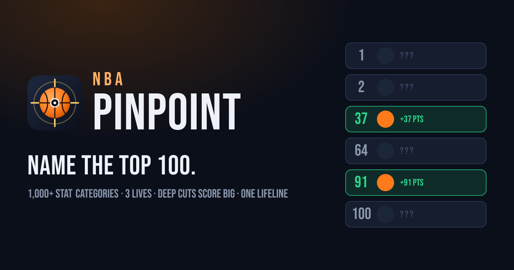

# NBA Pinpoint



A stat-leaderboard guessing game. You get a random NBA category, like *Most dunks in 2015-16*, *Most career playoff steals*, or *Highest usage rate in 2022-23*. Name as many of its **top 100** players as you can.

## Rules

- **Points = rank.** A correct guess scores the player's rank: #100 is worth 100 and #1 is worth 1, so deep cuts pay off. The player's photo and name are revealed on the board.
- **3 lives.** A wrong guess costs a life and tells you where that player actually ranked.
- **Lifeline.** When you lose your last life, you get one lifeline: name a player ranked **#90–#100**. Hit it and you get a life back. Miss it and the game ends.
- Guessing the same player twice costs nothing. Typos don't count either: you can only pick names from the autocomplete list.

## Categories

There are 1,000+ categories, built from Basketball-Reference:

- **Single season** (2001-02 to 2025-26): totals, per-game, shooting percentages, advanced stats (PER, WS, BPM, VORP, usage…), dunks, and-ones, charges drawn, shooting fouls, bad-pass turnovers, and more.
- **Career**: all-time regular-season leaders.
- **Playoffs**: all-time playoff leaders.

Rate stats use qualifiers (for example, 70% of games played for per-game stats, and a minimum number of makes for percentages). Categories where fewer than 100 players record the stat are left out.

## Development

```bash
npm install
npm run dev
```

### Rebuilding the data

```bash
python3 scripts/fetch_bbref.py .cache/bbref               # rate-limited download, cached
pip install beautifulsoup4 lxml nba_api
python3 scripts/build_data.py .cache/bbref                # writes public/data/
```

`nba_api` is only used for its bundled offline player list, which maps players to NBA.com headshot IDs.

Data © Sports Reference LLC. This project is not affiliated with the NBA.
